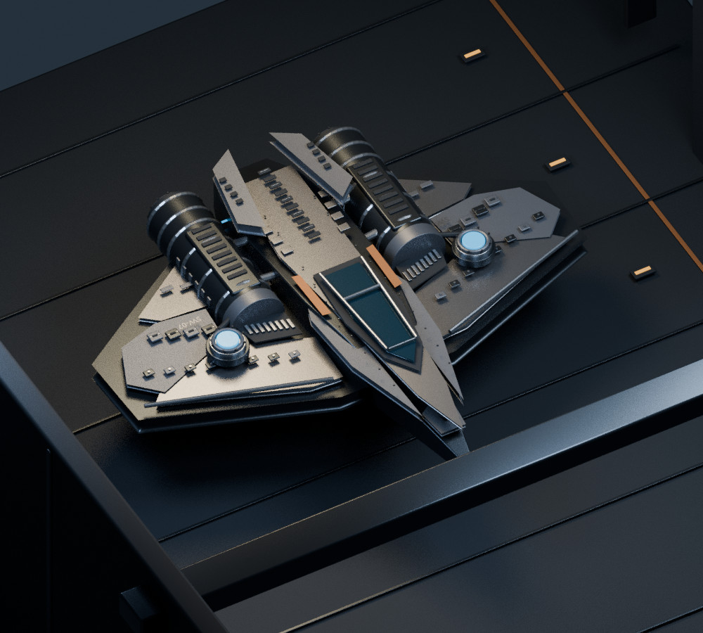
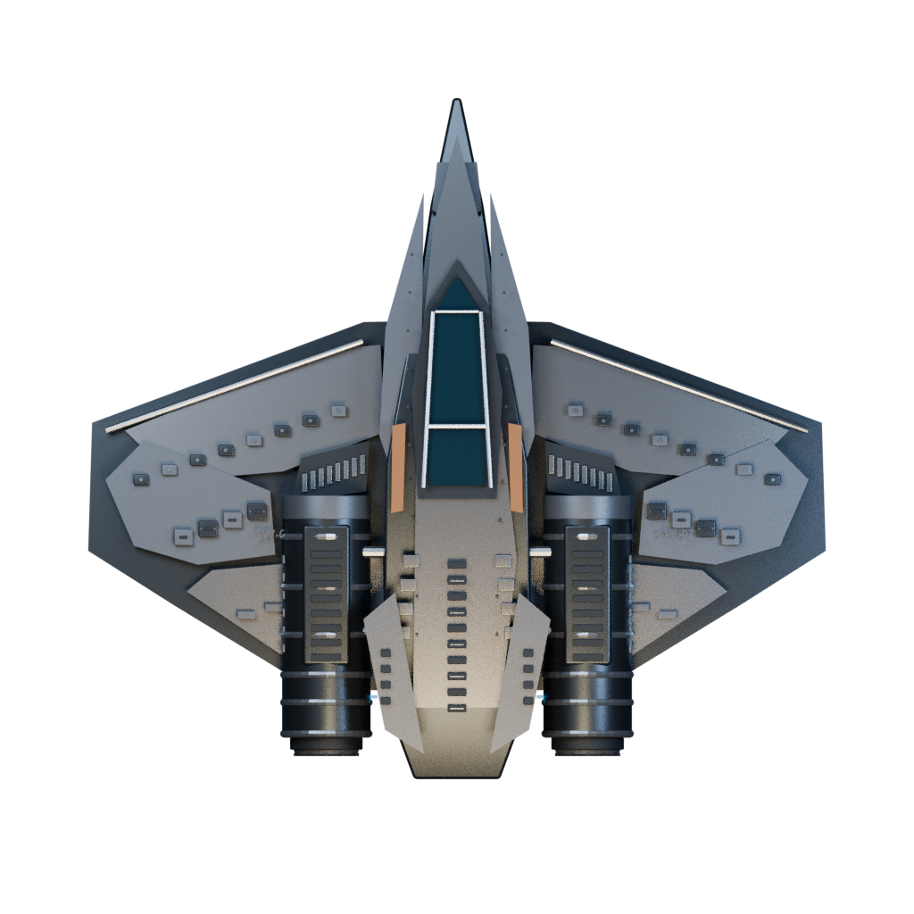

# SHATTERWAKE – Hero Fighter / Abnahmegalerie

**Status:** Vorschau, nicht freigegeben. Keine Android-Integration.

**Stilziel:** das vom Nutzer bestätigte, realistische, schwer gepanzerte
Sci-Fi-Schiff im Industriehangar. Diese erste bearbeitbare 3D-Konstruktion hat
echte Module und hochwertige Renderausgaben, entspricht dem Konzeptbild aber
noch nicht in allen Oberflächen- und Detailqualitäten. Ehrliche visuelle
Beurteilung vor einem Merge.

## 1. Rohzustand der Sternenwerft

## 2. Schnellfeuer: vollständig montiertes Zwillingsgeschütz

## 3. Schild: zweifacher physischer Schildgenerator

## 4. Drohnen: montierte Start- und Ladedocks

## 5. Tatsächliche Gameplay-Ausrichtung

## Bearbeitbare Quelle / Integration

- **Blender-Master:** [hero_fighter.blend](hero_fighter.blend)
- **Parametrischer Modellaufbau:** [build_master.py](build_master.py)
- **Produktionsfertige, aber noch nicht freigegebene transparente PNGs:** [staging/game](staging/game) und [staging/werft](staging/werft)
- **Aus tatsächlicher Kameraprojektion bestimmte Koordinaten:** [staging/fighter_layout.json](staging/fighter_layout.json), wird durch den separaten Layout-Workflow exportiert
- **Herkunft/Lizenz:** [LICENSE_SOURCES.md](LICENSE_SOURCES.md) (eigene Konstruktion, keine übernommenen Fremdmodelle)

Der bereits veröffentlichte Android-Build nutzt diese Grafiken **nicht**.
Ein Wechsel erfolgt erst nach ausdrücklicher Freigabe.
