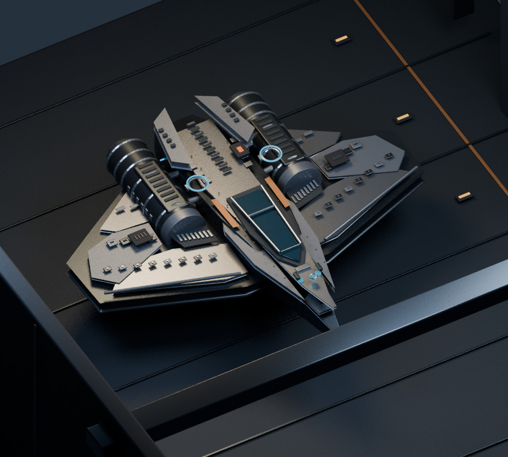
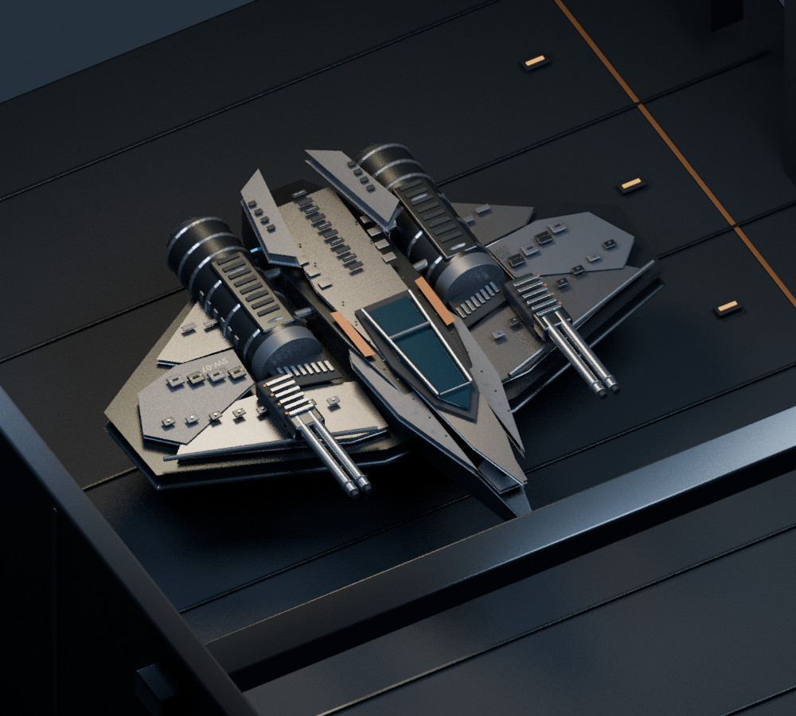
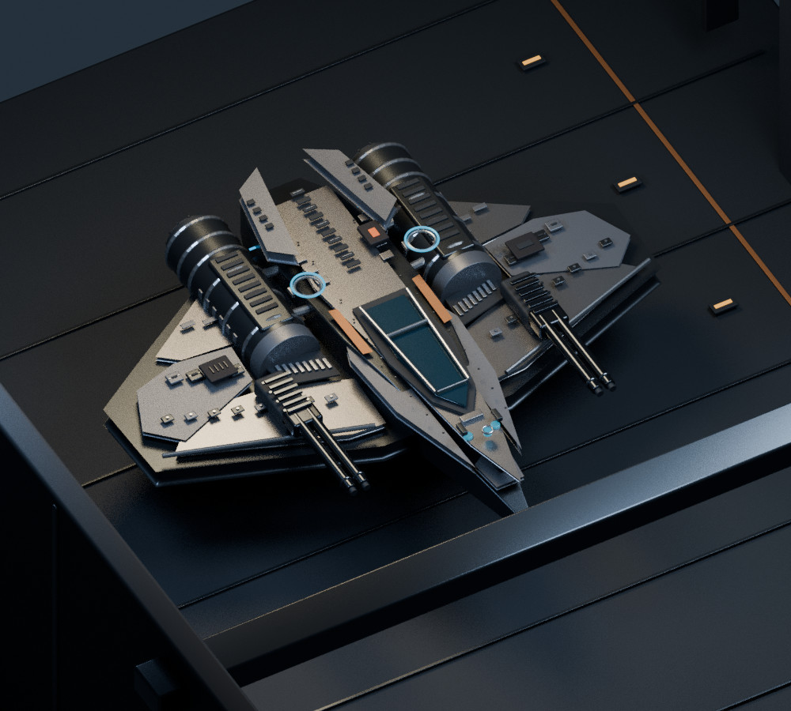
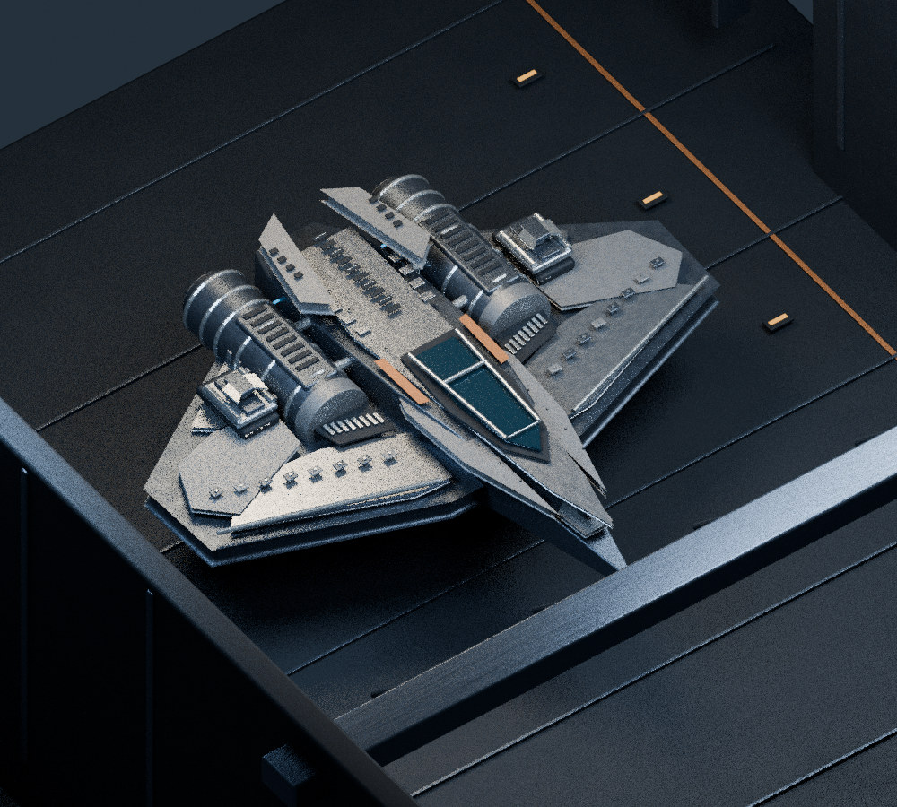
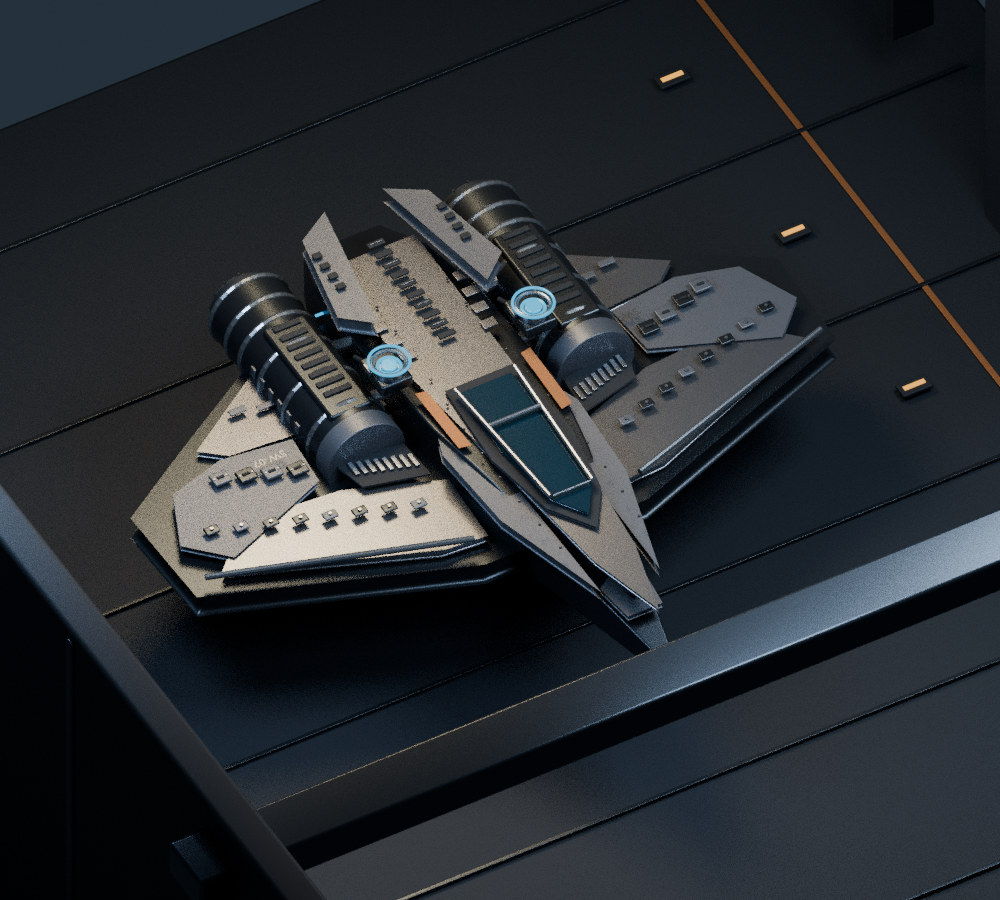
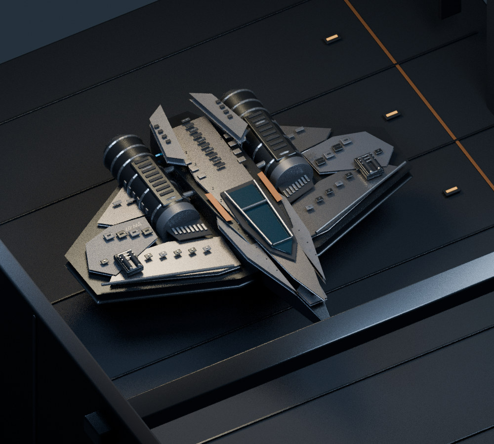
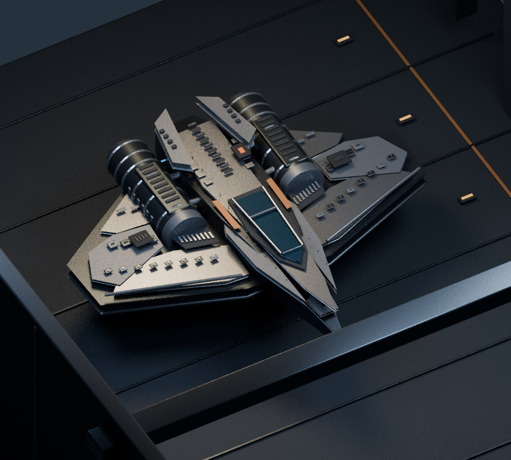

# SHATTERWAKE – Hero Fighter / Abnahmegalerie

**Status:** Vorschau, nicht freigegeben. **ART-002:** Glatte, vollständig körnungsfreie Metallshader; neue Renderbilder werden mit derselben Blender-Masterszene erstellt. Keine Android-Integration.

**Stilziel:** das vom Nutzer bestätigte, realistische, schwer gepanzerte
Sci-Fi-Schiff im Industriehangar. Diese erste bearbeitbare 3D-Konstruktion hat
echte Module und hochwertige Renderausgaben, entspricht dem Konzeptbild aber
noch nicht in allen Oberflächen- und Detailqualitäten. Ehrliche visuelle
Beurteilung vor einem Merge.

## 1. Rohzustand der Sternenwerft

## 2. Schnellfeuer: vollständig montiertes Zwillingsgeschütz

## 3. Erhöhter Schaden: dunkle Kanonen (neue Variante)

Die Kanonen haben dieselbe Form und dieselben Befestigungspunkte wie bei
Schnellfeuer, aber eine dunkle, glatte Gunmetal-Oberfläche. Bei der späteren
Integration wird je nach Upgrade-Zustand entweder das helle Geschütz (ID 0)
oder das dunkle Geschütz (ID 1) ausgewählt – beide niemals gleichzeitig.

## 4. Schild: zweifacher physischer Schildgenerator

## 5. Drohnen: montierte Start- und Ladedocks

## 6. Sternenmagnet

## 7. Zielkorrektur

Zielkorrektur ist im Spiel in fünf 3-%-Stufen vorgesehen (bis 15 %).

## 8. Spezialladungen

## 9. Reparatur und Schäden

Die vollen Rumpf-HP werden ohne Beschädigungs-Overlay gezeigt. Fehlende
Rumpf-HP wählen aus drei Schadensstufen; bei Reparaturen reduziert sich
die sichtbare Schadensstufe entsprechend. Die Darstellung ist separat
vom numerischen Schaden/HP-System.

## 10. Tatsächliche Gameplay-Ausrichtung

## Bearbeitbare Quelle / Integration

- **Blender-Master:** [hero_fighter.blend](hero_fighter.blend)
- **Parametrischer Modellaufbau:** [build_master.py](build_master.py)
- **Produktionsfertige, aber noch nicht freigegebene transparente PNGs:** [staging/game](staging/game) und [staging/werft](staging/werft)
- **Aus tatsächlicher Kameraprojektion bestimmte Koordinaten:** [staging/fighter_layout.json](staging/fighter_layout.json), wird durch den separaten Layout-Workflow exportiert
- **Herkunft/Lizenz:** [LICENSE_SOURCES.md](LICENSE_SOURCES.md) (eigene Konstruktion, keine übernommenen Fremdmodelle)

Der bereits veröffentlichte Android-Build nutzt diese Grafiken **nicht**.
Ein Wechsel erfolgt erst nach ausdrücklicher Freigabe.
